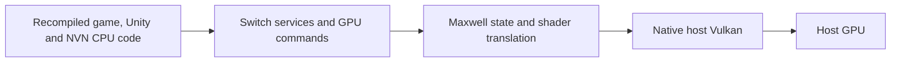

# Native rendering investigation

Updated: 2026-10-13. R06 extension requested by the user: investigate graphics
integration that makes the eventual Zarvot recomp more native while preserving
rendering, synchronization and game behavior. E035/E036 remains the fixed
candidate for the deferred CPU performance comparison.

## Observed engine and current path

Read-only inspection of existing exported metadata confirms Unity 2017.4.10f1
and IL2CPP metadata version 24. The module identifies SwitchPlayer.nss and NVN
initialization. Existing output contains cooked Unity assets; the local project
inventory did not find a Windows Unity player or the original Unity project.
No new assets were extracted and no game files are published here.

The CPU recomp does not currently intercept NVN calls with host-native graphics
replacements. SVC/IPC reaches nvdrv, GPFIFO entries enter the GPU command queue,
the Maxwell decoder prepares graphics state, and RasterizerVulkan records native
Vulkan draw calls. GPU work already executes on the host GPU; the remaining
compatibility cost includes command/state/shader translation, resource handling
and synchronization. Zero CPU JIT transitions do not remove those layers.

Source anchors in third_party/suyu/src/:

- core/arm/recomp/arm_recomp.h: compiled execution yields SVCs to the kernel.
- core/hle/service/nvdrv/devices/nvhost_gpu.cpp: SubmitGPFIFOImpl.
- video_core/gpu.cpp and dma_pusher.cpp: GPU entries and command decoding.
- video_core/engines/draw_manager.cpp: Maxwell draw dispatch.
- video_core/renderer_vulkan/vk_rasterizer.cpp: Draw/PrepareDraw.
- video_core/renderer_vulkan/vk_pipeline_cache.cpp: shader IR/SPIR-V and pipelines.

Unity's [2017.4 IL2CPP documentation](https://docs.unity3d.com/2017.4/Documentation/Manual/IL2CPP-HowItWorks.html)
describes conversion to C++ followed by compilation/linking for the target
platform. [AssetBundle builds also target a platform](https://docs.unity3d.com/2017.4/Documentation/Manual/AssetBundles-Building.html).
The Switch player and metadata do not supply a rebuildable Windows project or
a supported drop-in player replacement.

## Candidate directions

| Direction | Recomp-specific work | Evidence required before adoption |
|---|---|---|
| Native replacement of a narrow command-generation routine | Replace a measured, understood guest routine while retaining the current renderer | Exact ABI, input/output/memory/fence equivalence and equivalent-work speedup |
| NVN-to-Vulkan bridge | Intercept a recovered graphics API boundary before GPU command emulation | Object/pointer mappings, buffers/textures/shaders, lifetimes, queues, fences and CPU/GPU coherence; compare output with the current renderer |
| Recomp shader/pipeline preparation | Pretranslate known shaders or reduce demonstrated runtime pipeline waits | Measured misses/waits, hardware/driver-specific cache identity and unchanged shader/rendering behavior |
| Unity engine rehosting | Recover game/engine integration for a native player | Compatible engine, game code, platform assets and runtime interfaces; substantially more reconstruction than the current recomp |

There is no implemented native NVN bridge or Unity rehost in this project.
Unity metadata may help identify game functions; it is not portable engine source.
The incremental recommendation is measurement, then one small verified boundary
replacement if command generation or translation is actually significant.

## Diagnostics available without rebuilding

The exact preserved E017 host (SHA 43ae6250...) already contains
SUYU_STALL_PROBE. Enable it only for a separate diagnostic run with the launcher's
-StallProbe switch. The ordinary prepared comparison explicitly disables it,
including any ambient inherited value; the calling environment is restored.
launch.json records stall_probe_requested. A request alone does not prove a
compatible host emitted records; valid STALL observations provide that evidence.

The probe reports presentation intervals over 100 ms and completed CPU wall-time
scope totals: GPU-emulation-thread input wait, direct-draw preparation, scheduler
wait, pipeline-build wait, swapchain acquire/present and frame wait. Scopes run
on different threads, overlap and can straddle reporting intervals. They are not
additive frame-time percentages or hardware GPU execution measurements.
gpu_idle means the emulation thread waited for commands, not hardware GPU idle.
No records can mean the probe was off, the host lacked it, or no qualifying
interval was observed; it does not prove smooth rendering.

Use scripts/analyze-zarvot-stalls.py on the saved log and matching launch metadata.
Its sanitized JSON preserves record chronology and separates request/observed
state, complete records and malformed/truncated records. Keep raw logs local.

Next measurement order:

1. Run the deferred E035/E036 opening Story comparison without the probe, using
   the fixed images, E017 host/E016 initial profile and verified recorders.
2. Run a separate copy with -StallProbe for the same named combat route. Its
   extra timing/atomic/logging work must not be credited as a performance change.
3. Correlate slow intervals with captures, CPU samples and probe scopes. Hardware
   GPU timing/utilization requires a separate suitable GPU capture if still needed.
4. Select a native boundary prototype from measured work; keep the current
   renderer as the correctness reference and retain the prepared candidate.

The old E028 combat trace places 68.44% of CPU leaf samples in compiled modules,
74.41% during the dip. This supports testing the CPU-copy changes but neither
excludes GPU waits nor identifies the critical path. Old E017/E028 logs contain
no STALL observations. No graphics speedup or GPU bottleneck is established yet.

E038 verified the complete diagnostic path in a separate boot-only run:
18 valid STALL records, zero malformed records or metadata conflicts; 90 complete
coverage reports with advancing compiled counts and zero recorded fallbacks.
The full title rendered and game/recorder exited normally. This proves the
preserved host can emit parsable records, not that startup stalls explain combat.
No game or host rebuild, gameplay input or hardware GPU capture was performed.
